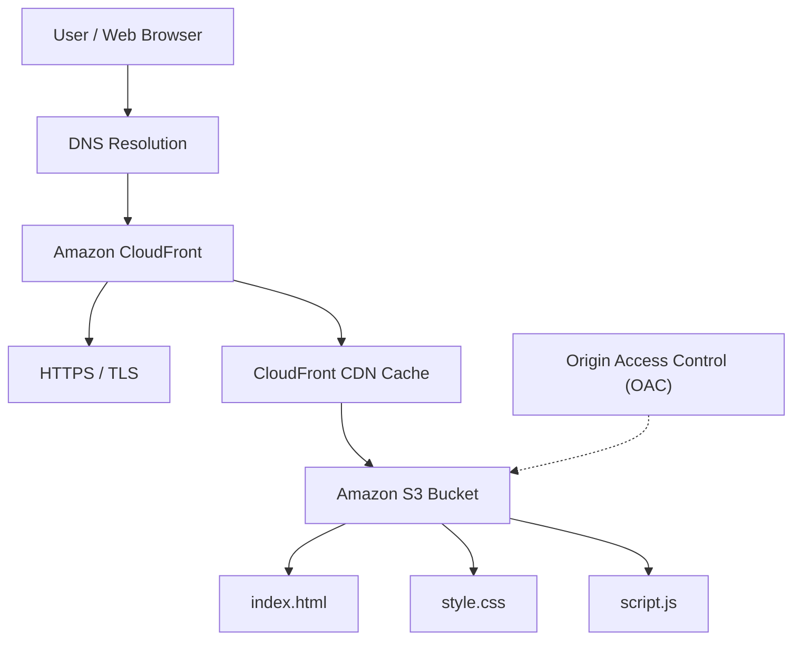

# AWS Static Website Deployment Architecture

## Project Overview

This project demonstrates the deployment of a responsive static portfolio website using Amazon S3 and Amazon CloudFront.

## Architecture Diagram

## AWS Components

| Component | Purpose |
|---|---|
| Amazon S3 | Stores static website files |
| Amazon CloudFront | CDN for global content delivery |
| Origin Access Control | Secures access between CloudFront and S3 |
| AWS Certificate | Provides HTTPS through CloudFront |
| DNS | Resolves the CloudFront distribution hostname |

## Request Flow

1. A user opens the CloudFront website URL.
2. DNS resolves the CloudFront hostname.
3. The request reaches the nearest available CloudFront edge location.
4. CloudFront checks its cache for the requested content.
5. If content is not cached, CloudFront retrieves it from the private S3 origin using OAC.
6. CloudFront delivers the website to the browser over HTTPS.

## Website Files

- `index.html` – Website structure
- `style.css` – Website design and responsive layout
- `script.js` – Mobile navigation functionality

## Security

- S3 Block Public Access remains enabled.
- CloudFront uses Origin Access Control.
- HTTPS is enabled.
- HTTP requests are redirected to HTTPS.

## Domain Configuration

The website uses the default CloudFront distribution domain.

A separately registered custom domain and its DNS records have not been configured.
